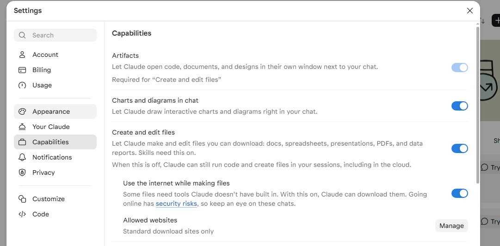
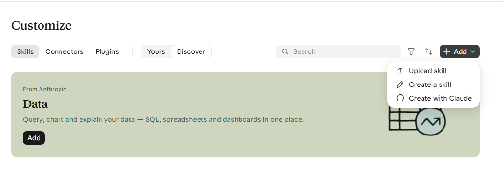
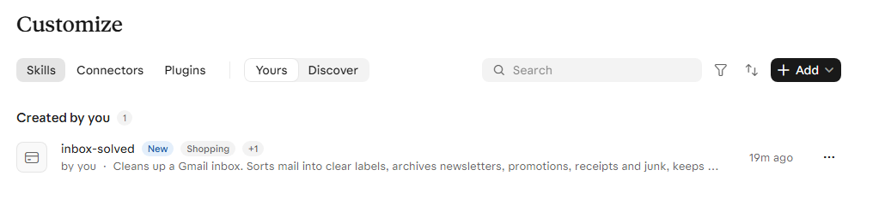
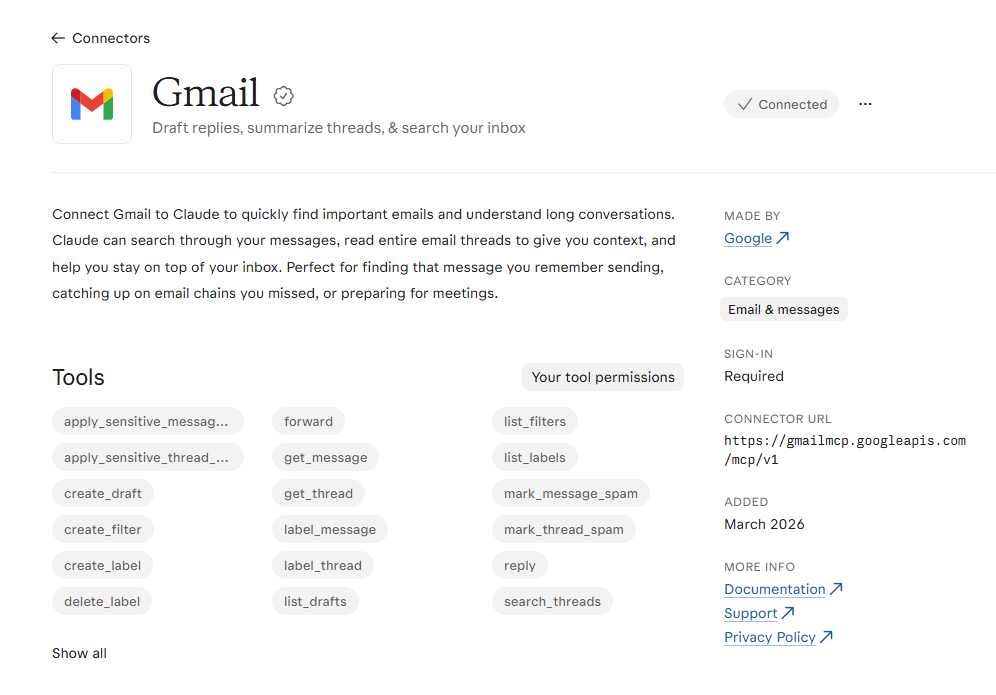
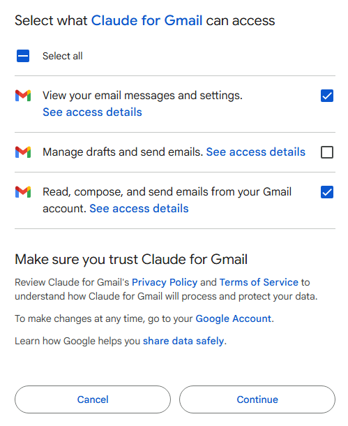
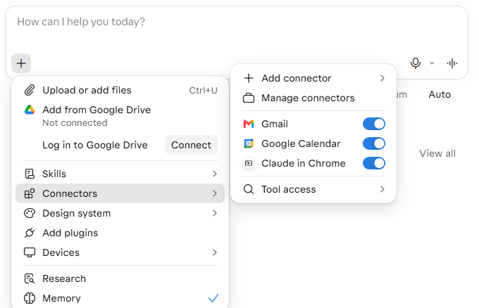

# Inbox Solved

**A free add-on for Claude that cleans up your Gmail inbox.** Type "clean up my inbox" and Claude sorts your mail, moves the newsletters, promotions, receipts and junk out of the way, and tells you what actually needs you.

- Nothing is ever deleted. Mail Claude moves out of your inbox stays in Gmail, and one search puts it all back.
- Claude never sends, replies to or forwards anything.
- Claude shows you the plan and waits for your yes before it changes anything.

No coding. No installing. About five minutes to set up.

---

## What you need

- A **Claude** account (the free plan works). Sign up at [claude.ai](https://claude.ai).
- A **Gmail** account.
- A computer with a web browser.

## Setup: five minutes, once

### Step 1: Download the skill

Download **[inbox-solved.zip](https://github.com/garrettgosselink-eng/inbox-solved/raw/main/inbox-solved.zip)**. Don't open it; you'll upload it as is.

### Step 2: Check one setting

1. Go to [claude.ai](https://claude.ai) and sign in.
2. Click **your name** in the bottom-left corner, then **Settings**.
3. Click **Capabilities**.
4. Make sure **Create and edit files** is switched on. It says "Skills need this on." It's usually on already. (Older versions of the page call it **Code execution and file creation**.)

Shortcut: go straight to [claude.ai/settings/capabilities](https://claude.ai/settings/capabilities).

### Step 3: Add the skill to Claude

1. Open **Customize** and click the **Skills** tab.
2. Click the **+ Add** button in the top-right corner, then **Upload skill**.
3. Pick the `inbox-solved.zip` file you downloaded.

4. **inbox-solved** now shows up under **Created by you**. That's it; there's nothing to switch on.

### Step 4: Connect your Gmail

1. Open **Customize** and click the **Connectors** tab.
2. Find **Gmail** and click **Connect**.

3. Sign in to Google with the Gmail account you want cleaned up.
4. Google shows three boxes. **Keep the first and third boxes checked:** "View your email messages and settings" and "Read, compose, and send emails." The third one lets Claude label and move mail. The middle box (drafts) isn't needed. Click **Continue**.

**Have more than one Google account?** Google may offer the wrong one. Sign in from a private browser window, or sign out of the other account first.

**Gmail already says Connected?** Click it and check which account it uses. To switch accounts, click the **three dots** next to Connected, choose **Disconnect**, then connect again with the right account.

### Step 5: Clean up your inbox

1. Start a new chat.
2. Click the **+** button below the message box, hover over **Connectors**, and make sure **Gmail** is switched on.

3. Type: **clean up my inbox**

Claude looks at your newest 50 conversations, shows you a plan, and waits. Say **yes** and it does the work, usually in two or three minutes, then gives you a short list of what needs your attention. Say "do the next 50" to keep going.

---

## Questions

**Will it delete my email?**
No. Inbox Solved can't delete anything. It only adds labels and moves mail out of your inbox. Everything it moves stays in Gmail under **All Mail**.

**How do I put everything back?**
Ask Claude to "undo Inbox Solved." Or do it yourself in Gmail: search for `label:inbox-solved-archived`, select everything, and click **Move to Inbox**.

**What stays in my inbox?**
Anything from a real person, anything starred, and anything about money, accounts, security, taxes, legal matters, health or school. When Claude isn't sure, it leaves the email where it is.

**What are the new labels in my Gmail?**
Inbox Solved files everything under one label, **Inbox Solved**, with sub-labels for each kind of mail: Urgent, Reply Needed, Review, FYI, Receipts, Newsletters, Junk and Archived. Click any of them in Gmail's left sidebar to see what's inside.

**Claude keeps asking permission for every change. Can I stop that?**
Most people never see a prompt. If you do, choose the option to always allow it. Or go to **Customize > Connectors > Gmail > Tool permissions** and set the labeling tools to **Always allow**. Leave sending on **Needs approval**; Inbox Solved never sends anything anyway.

**Does it read my email?**
Claude reads your mail to sort it, the same way Claude reads anything you ask it to look at. Inbox Solved doesn't send your email anywhere else.

**What does it cost?**
Nothing. Inbox Solved is free, and it works on Claude's free plan.

---

Published by Kenyon Business Strategists, LLC. Free to use and share under the [MIT License](LICENSE).
